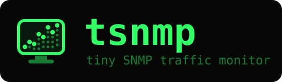
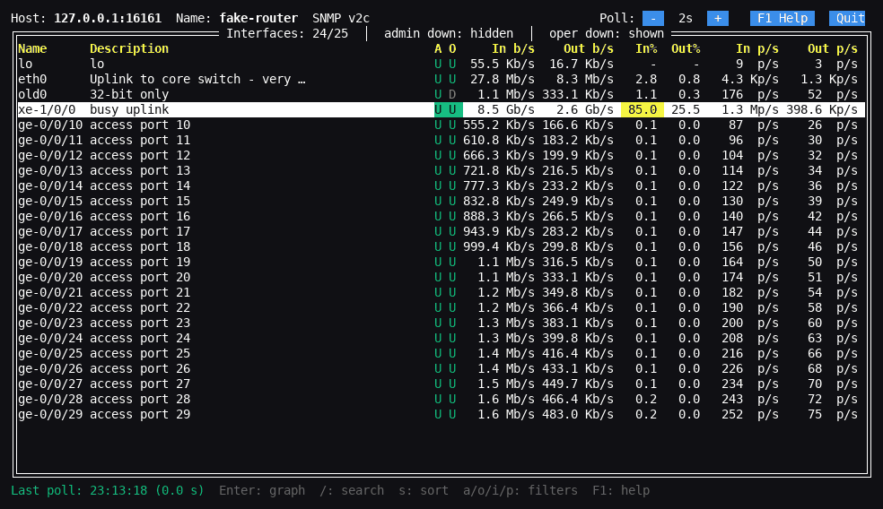
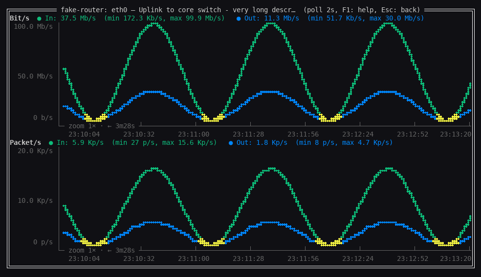

<p align="center"></p>

<p align="center">
  <a href="https://github.com/kzoli71/tsnmp/actions/workflows/build.yml"></a>
  <a href="https://github.com/kzoli71/tsnmp/actions/workflows/lint.yml"></a>
  <a href="https://github.com/kzoli71/tsnmp/releases/latest"></a>
  <a href="https://github.com/kzoli71/tsnmp/commits/main"></a>
  
  
  <a href="LICENSE"></a>
</p>

<p align="center"><b>English</b> | <a href="Readme.hu.md">Magyar</a></p>

# tsnmp – SNMP interface traffic monitor

A text user interface (TUI) program that monitors all interfaces of a device
over SNMPv2c or SNMPv3: In/Out bit/s and In/Out packet/s.
It runs on Linux and on Windows 10 or later, including Windows Server 2016 and later
(Windows Terminal / console). Older Windows versions are not supported by Go 1.21+.

<p align="center"></p>
<p align="center"></p>

## Download

Ready-made binaries for Linux and Windows (amd64) are on the
[Releases](https://github.com/kzoli71/tsnmp/releases) page, together with
`checksums.txt` (SHA-256). `tsnmp -version` prints the version of the program.

## Build

Requires Go 1.24+.

```sh
go build -trimpath -o tsnmp .                                  # Linux
GOOS=windows GOARCH=amd64 go build -trimpath -o tsnmp.exe .    # Windows (cross-compiled)
go test ./...
```

GitHub Actions (`.github/workflows/build.yml`) runs the tests and builds the Linux and
Windows amd64 binaries on every push to `main`; they can be downloaded from the run's
"Artifacts" section.
A second workflow (`.github/workflows/lint.yml`) runs `staticcheck` and `gosec` with a
newer Go (1.26) than the one the program is built with.
Pushing a `v*` tag (e.g. `v1.0.1`) runs `.github/workflows/release.yml`: after the
checks, [GoReleaser](https://goreleaser.com/) (`.goreleaser.yaml`) builds the release
archives, the checksums and the changelog, and uploads them to a draft GitHub release.
Before tagging, update the version in `versioninfo.json` and run `go generate`.

The Windows exe is Authenticode-signed with a Certum SimplySign (cloud) code signing
certificate before the release is published, by hand on the maintainer's machine with
`sign-release`, a separate script kept outside this repository
(`kzoli71/sign-release`). It downloads the Windows zip from the draft, signs
`tsnmp.exe` with [ssign](https://github.com/Le-Syl21/ssign) (with a timestamp from
`time.certum.pl`), verifies the signature with `osslsigncode`, uploads the re-packed
zip and the updated `checksums.txt`, and publishes the release after confirmation. It
asks for the current 6-digit code of the SimplySign mobile app (hidden input):

```sh
CERTUM_EMAIL=you@example.com sign-release -R kzoli71/tsnmp \
    -a 'tsnmp_{version}_windows_amd64.zip' v1.0.1
```

The Windows exe gets version info, a manifest and the program icon embedded
(`versioninfo.json`, `tsnmp.exe.manifest`, `assets/tsnmp.ico` →
`resource_windows_*.syso`). Without version info and a manifest Defender is more
likely to report a false positive (e.g. `Trojan:Win32/Wacatac.B!ml`). Regenerate
after changing any of these files: `go generate`. Do not use `-ldflags="-s -w"`:
a stripped exe looks more suspicious to antivirus software.

### Testing without a real device

```sh
go run ./tools/fakeagent            # fake SNMP agent: 127.0.0.1:16161, community "public"
./tsnmp 127.0.0.1:16161             # or without an address, on the login screen
./tsnmp -v 3 -u tsnmp -A authpass123 -X privpass123 127.0.0.1:16161   # SNMPv3 (SHA/AES)
```

Flags: `-listen`, `-community`, `-extra` (number of additional interfaces, default 50),
`-delay` (wait before every response, e.g. `50ms`, to simulate a slow device),
`-refresh` (counters change only at this interval, e.g. `2s`, like a router's
counter cache), `-hot` (a 10 Gb/s port with a constant 85% load), and for SNMPv3
`-user` (default `tsnmp`; `""` turns SNMPv3 off), `-auth` / `-authpass` (default
`SHA` / `authpass123`), `-priv` / `-privpass` (default `AES` / `privpass123`;
`-auth none` or `-priv none` lowers the security level), `-context` (the only
accepted context name, default: the default context). The agent answers v2c
with the community and v3 with the user at the same time, and sends the SNMPv3
error reports (unknown user, wrong password, wrong security level, unknown context)
like a real device.
Commands on standard input while running: `reset N` (zero the counters of
ifIndex N), `reboot` (agent restart), `down` / `up` (connection lost /
restored), `nodisc` / `disc` (stop / resume answering discovery requests).

## Usage

```sh
tsnmp [-v 2c] [-c community] [address[:port]]
tsnmp -v 3 -u user [-a proto -A password [-x proto -X password]] [-n context] [address[:port]]
```

The address is an IP address or hostname, optionally with a port (default port: 161;
`[address]:port` for IPv6). If the address is given, the program connects right away,
otherwise it asks for the address and the SNMP settings on the login screen
(Enter in any text field connects).

Started without any arguments (`tsnmp`), the program does not connect anywhere and
does not print a usage message: it opens the login screen with the defaults
(SNMP version `v2c`, community `public`, empty address), with the cursor in the
address field. Options given without an address (e.g. `tsnmp -v 3 -u admin`) only
fill in the form. Esc or the `Quit` button exits; `tsnmp -h` prints the
command-line help.

The `SNMP version` drop-down selects the fields:

- **v2c:** community (default: `public`).
- **v3:** user name, authentication protocol (`none`, `MD5`, `SHA`, `SHA224`,
  `SHA256`, `SHA384`, `SHA512`) and password, privacy (encryption) protocol
  (`none`, `DES`, `AES`, `AES192`, `AES256`, `AES192C`, `AES256C`) and password,
  and the context name (empty: the default context; needed e.g. when the agent
  serves a VRF / VPRN or another virtual instance under a named context).
  The security level follows from the protocols: no authentication = noAuthNoPriv,
  authentication without privacy = authNoPriv, both = authPriv. Passwords must be
  at least 8 characters. `AES192` / `AES256` use the Blumenthal key extension,
  `AES192C` / `AES256C` the Reeder one (used e.g. by Cisco); devices differ, so if one
  gives a decryption error, try the other.

On the command line the same options are `-v`, `-c`, `-u`, `-a` / `-A`, `-x` / `-X`, `-n`
(net-snmp style; with only a password given, the protocol defaults to `SHA` / `AES`).
`tsnmp -licenses` prints the licenses (see [License](#license)) and exits;
`tsnmp -version` prints the version and exits.
Passwords on the command line are visible to other users of the machine (process list):
on a shared machine type them on the login screen instead. SNMPv3 errors are explained
(e.g. `authentication failed (wrong authentication password or protocol)`), and the
header shows the SNMP version and security settings.

Main screen:

| Key / mouse               | Function                                  |
|---------------------------|-------------------------------------------|
| `+` / `-`, `[+]` / `[-]`  | Set the poll interval (1–300 s, default: 5 s) |
| `↑` / `↓`                 | Move between interfaces                   |
| `a` / `A`                 | Show/hide admin down interfaces (default: hidden) |
| `o` / `O`                 | Show/hide oper down interfaces (default: shown) |
| `i` / `I`                 | Show/hide the Idx column (default: hidden) |
| `p` / `P`                 | Show/hide the p/s columns (for narrow screens) |
| `/`                       | Search in name / description (Enter: keep, Esc: clear) |
| `s` / `S`                 | Cycle sort order: ifIndex, name, description, In/Out b/s, In%/Out%, In/Out p/s (traffic and utilization descending; skipped when the p/s columns are hidden) |
| `r` / `R`                 | Restart the measurement with confirmation: all measured data and counters are deleted (the interface list is kept) |
| `F1`, `[F1 Help]`         | Help (`l` in the help: licenses)          |
| `Enter`, click            | Traffic graph of the interface            |
| `Esc`, `q`, `[Quit]`      | Quit with confirmation (with an active search, `Esc` clears the search first) |

Columns: `A` / `O` are the admin / oper status (`U` = up, `D` = down), `In%` / `Out%`
the utilization relative to the interface speed (yellow above 70%, red above 90%;
`-` if the device reports no speed). The bottom line shows the time and duration
of the last poll; if a poll takes longer than the poll interval, a yellow warning appears.
The width of the description column follows the screen (10–30 characters).

If the connection is lost, a red `⚠ CONNECTION ERROR – last data: …` warning appears
in the table title and at the bottom of the graph, and the traffic values turn gray.
If only refreshing the interface list (discovery) fails, measuring goes on with the
known list, and discovery is retried after 30 seconds.

If the measured rate of an interface exceeds its speed, a yellow warning appears in the
bottom line and at the bottom of the graph (for one minute). On a physical port this means
the router updates its counters less often than the poll interval (many routers refresh the
counters seen over SNMP only every few seconds), so single measurements are alternately too
high and too low (their average is correct). Fix: a longer poll interval (e.g. 10 s or more).

Graph view:

| Key / mouse                        | Function                                      |
|------------------------------------|-----------------------------------------------|
| `←` / `→`                          | Scroll back / forward by one point            |
| `Shift+←` / `Shift+→`, `PgUp` / `PgDn` | Scroll by half / full screen              |
| `Home` / `End`                     | Live view / oldest measurement                |
| `z` / `Z`                          | Cycle zoom forward / back: 1× → 5× → 30× → 120× → 1× (that many measurements averaged per point) |
| `r` / `R`                          | Restart the measurement (with confirmation)   |
| `Esc`, right click                 | Back to the list                              |

The x axis has a time label every few columns: the time of the point plotted in that
column (with the date if it is not from today). Points are evenly spaced per
measurement, not proportionally to time, so after a poll interval change or a missed
poll the time between labels can differ. The axis line shows the zoom level, the
time span in view and, when scrolled back (the graph then stays in place while
measuring goes on), the `◀ HISTORY` marker.

Bit/s and Packet/s panels (In = green, Out = blue, overlap = yellow), refreshed
continuously. Besides the current value, the legend shows the minimum and maximum
over the plotted period; `Esc` or a right click goes back to the list.

## Notes

- Uses the 64-bit `ifHC*` counters; if the device does not support them, it falls
  back per interface to the 32-bit `ifTable` counters automatically (with wrap handling).
- Rates are computed from the device's own clock (`sysUpTime`, queried in every
  request), so network delay and retries do not distort them.
- Against false spikes: a device restart (`sysUpTime` goes back), a counter reset
  (`ifCounterDiscontinuityTime` changes), or a 32-bit "wrap" that would mean more
  traffic than the interface speed discards that measurement.
- Description: `ifAlias`, or `ifDescr` if that is empty; truncated above 30 characters.
- Every poll queries the status and counters of all interfaces with GetBulk requests,
  several columns at once, so all counters of an interface come from the same response
  (admin down interfaces are measured too, just hidden by default). Interfaces with
  32-bit counters only are queried with targeted GET requests if there are few of them
  (at most 36), otherwise by walking the whole 32-bit table.
- Names / descriptions / speeds are refreshed every 60 seconds (and when a new
  interface appears).
- All measured data stays in memory while the program runs, in compact form
  (20 bytes per measurement; 1000 interfaces at a 5 s poll take about 0.35 GB / day).

## License

MIT, see [LICENSE](LICENSE).

The tsnmp logo and icon (the files in [assets/](assets/), and the icon embedded in
the Windows exe) are not covered by the MIT License: © 2026 Zoltán Kiss, all rights
reserved. They may be used unmodified to refer to the tsnmp project.

The licenses of the third-party software compiled into tsnmp (the Go standard library
and the Go modules) are in [THIRD_PARTY_LICENSES.txt](THIRD_PARTY_LICENSES.txt). The
program includes both texts: `tsnmp -licenses` prints them, and `l` in the help (`F1`)
shows them. The file is generated: `go run ./tools/licenses -write` regenerates it,
`go run ./tools/licenses` checks that it is up to date (CI runs the check).
